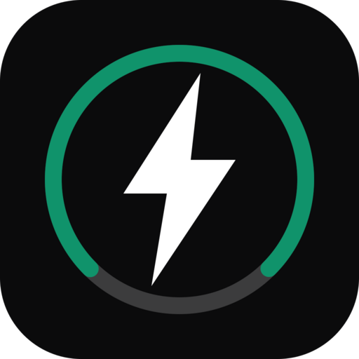
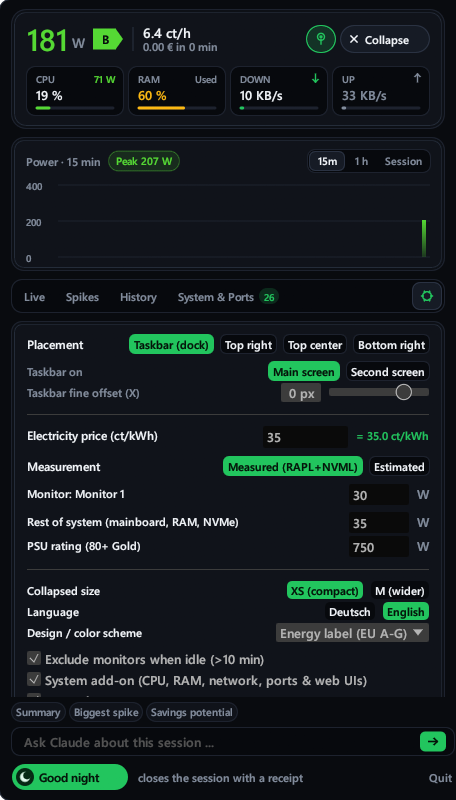
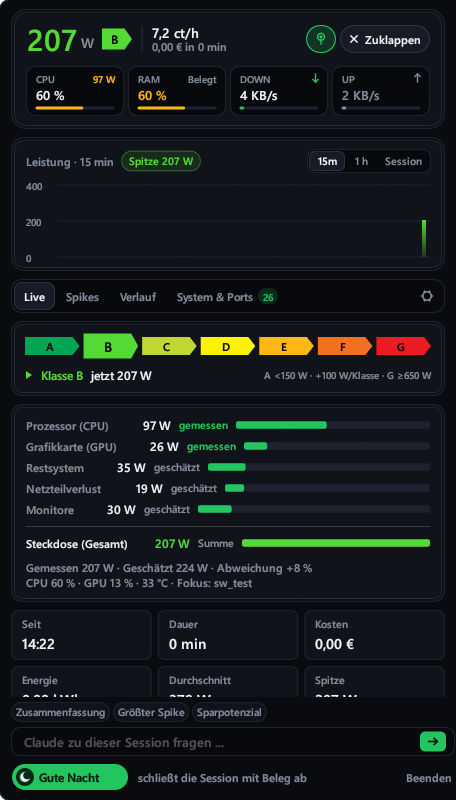
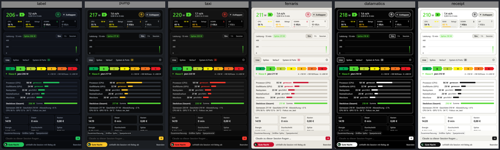

<p align="center"></p>

# Strom-Widget

A small, native **Windows 11 power widget**. It shows what your PC is drawing right now (in watts), what that costs per hour at your tariff, and what the current session has cost so far. It sits in your taskbar (or in a screen corner), uses almost no resources and expands into a detailed panel on click.

Written in Rust with [egui](https://github.com/emilk/egui). No Electron, no PowerShell loops, no background services.

> The interface is available in **English and German**, and amounts in **euro or US dollar** (Settings). On first start both follow your Windows settings. The tariff is entered in cents per kWh (ct or ¢).

<p align="center">
  <br>
  
  
  
</p>

## Features

**Live power and cost**
- Current total draw in W, cost per hour, cost and energy of the running session.
- Breakdown into CPU, GPU, rest of the system, PSU loss and monitors, each marked as *measured* or *estimated*.
- EU-energy-label style classes **A to G** for the current draw (A below 150 W, +100 W per class).
- 15 min / 1 h / session history chart.

**Sensors**
- CPU package power from the Windows "Energy Meter" (RAPL) counter, no admin rights needed.
- GPU board power, temperature and load via NVML (NVIDIA GPUs).
- A second purely estimated model (from CPU/GPU load) to compare against the measured one.
- CPU load, RAM, network down/up, foreground process.

**Sessions and spikes**
- Sessions are saved continuously, so they survive a hard power-off and are closed on the next start.
- Spike detection with the likely cause (top processes at that moment).
- Session summary: duration, kWh, cost, average, peak, spikes, CPU load per program, extrapolated cost per month.
- "Gute Nacht" button (and automatic summary on Windows shutdown) closes the session with a receipt.

**System and ports**
- Lists listening local ports with the owning process, and detects local web UIs (HTTP/HTTPS) so you can open them with a click.
- Biggest RAM and CPU consumers.

**Look and feel**
- English and German interface, switchable in the settings.
- Docks into the taskbar (main or second screen) or sits in a screen corner (top right, top center, bottom right). In the taskbar you can drag the strip sideways with the mouse, or nudge it in 10 px steps in the settings.
- Sizes XS and M, adjustable opacity when collapsed, optional always-on-top, optional start with Windows (current user only, no admin rights).
- Ten themes: Energy label, Graphite, Windows 11 Mica, Gas pump, Taximeter, Ferraris meter, Datamatics, Nord, Paper, Receipt.

<p align="center"></p>

**Optional: ask Claude**
- If the [Claude CLI](https://docs.claude.com/en/docs/claude-code) (`claude`) is installed and signed in, you can ask questions about the session or a single spike. The widget calls the CLI locally and stores no API key. Without the CLI this feature simply stays unused.

## Install / build

Requirements: Windows 10/11 and the stable Rust toolchain (MSVC).

```powershell
git clone <this repository>
cd strom-widget
.\build-release.ps1
```

The script builds without local paths in the binary and puts `Strom-Widget.exe` next to the script. `cargo build --release` works too.

`Strom-Widget.exe --self-test-screenshots <folder>` opens every tab once, saves a PNG of each into the folder and exits (used for the screenshots above).

## Settings and data

Settings and sessions are stored locally in `%APPDATA%\Strom-Widget`. Nothing is sent anywhere by the widget itself.

In the settings you can choose euro or dollar and set your tariff in your currency (`20`, `0,20`, `20 ct` or `$0.20` all mean 20 cents per kWh; no exchange rate is applied, enter your local tariff), the monitors and their draw, the rest-of-system draw, the PSU rating, size, theme, opacity and placement.

## Accuracy

CPU and GPU values are measured. Mainboard, RAM, drives, fans, monitors and PSU losses are **estimates**. This is not a wall-socket meter, and the widget says which numbers are measured and which are estimated.

## Credits

Created by [Nfinds](https://github.com/Nfinds) together with [Claude](https://claude.com/claude-code) (Anthropic), which wrote most of the code. The UI uses the Windows system fonts (Segoe UI, Consolas); no fonts are bundled.

## License

[MIT](LICENSE). Use it, change it, build your own things on top of it.
