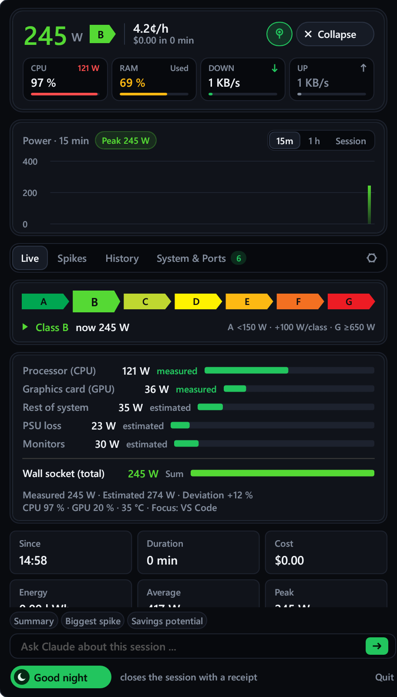
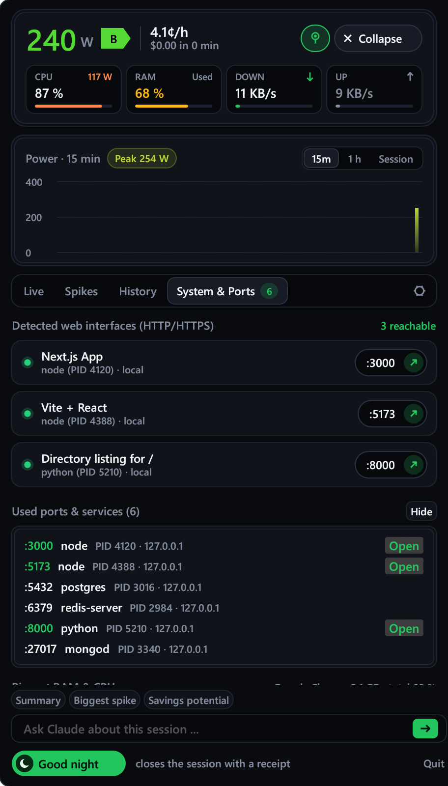

<p align="center"></p>

# Strom-Widget

A small native widget for Windows 11. It sits in your taskbar and shows three things: what your PC draws right now, what that costs per hour at your tariff, and what this session has cost so far. Click it to open a panel with the full breakdown, your local ports and your session history.

Written in Rust with [egui](https://github.com/emilk/egui). A single 5 MB exe: no Electron, no installer, no background service, no admin rights.

<p align="center"></p>

## Live watts, in money



The number in the strip is the whole PC at the wall socket. You see it as cost per hour, updating live.

The Live tab splits that number into processor, graphics card, rest of the system, power supply loss and monitors. Each line says whether it is **measured** or **estimated**, so you always know how much of the total is a guess.

The colour is the EU energy label. Below 150 W you are in class A, and every further 100 W moves you one class towards G.

Under the breakdown you get the session totals: start time, duration, kWh, average, peak and cost so far. Above it is a chart for the last 15 minutes, the last hour or the whole session.

<br clear="right">

## System & Ports



On a developer's machine, half a dozen things listen on localhost and nobody remembers which. This tab shows them.

- **Detected web interfaces.** The widget sends a plain HTTP request to each listening port, reads each page's title and lists what answers: your dev server, a dashboard, a local tool. One click opens it in the browser.
- **All listening ports**, each with the program behind it, its PID and the address it is bound to. You see what is blocking port 3000, and what is reachable from your network.
- **Biggest RAM and CPU consumers**, grouped by program rather than by process, so 24 browser processes show up as one line.

The tab label shows the count, so you notice when something new starts listening.

<br clear="right">

## Spikes, sessions and the receipt

- **Spikes.** When the draw is at least 60 W and 35 % above the load of the last two minutes, the widget records a spike and the programs that were busy at that moment.
- **Sessions survive a power cut.** They are saved continuously, so even a hard power-off loses nothing. The session is closed on the next start.
- **Good night.** One button (or Windows shutting down) closes the session and prints a receipt with:
  - duration, kWh, cost, average and peak
  - spikes
  - CPU load per program
  - what a month like this would cost
- **History** keeps every finished session with its total.

## Make it yours

<p align="center"></p>

- **Where it sits.** In the taskbar of your main or second screen, or in a corner (top right, top centre, bottom right). Drag the strip sideways along the taskbar, or move it in 10 px steps in the settings.
- **Ten themes:** Energy label, Graphite, Windows 11 Mica, Gas pump, Taximeter, Ferraris meter, Datamatics, Nord, Paper, Receipt.
- **English or German, euro or dollar.** On first start both follow your Windows settings; you can change either in the settings at any time.
- Two sizes, opacity when collapsed, always on top, start with Windows (current user, no admin rights).


**Your setup, your numbers.** In the settings you enter:
- your tariff in your currency (`20`, `0,20`, `20 ct` and `$0.20` all mean 20 cents per kWh)
- your monitors and what each one draws
- what the rest of your system draws
- your power supply's rating

The more of this you fill in, the better the estimates get.

**Optional: ask Claude.** If the [Claude CLI](https://docs.claude.com/en/docs/claude-code) is installed and signed in, you can ask questions about the session or about a single spike. The widget runs the CLI on your machine and stores no API key. Without the CLI the question field simply stays unused.

<br clear="right">

## How it measures

| Part | Source | |
|---|---|---|
| Processor | Windows "Energy Meter" counter (RAPL), no admin rights | measured |
| Graphics card | NVML board power, load and temperature (NVIDIA) | measured |
| Mainboard, RAM, drives, fans | the rest-of-system value in your settings | estimated |
| Power supply loss | from the load and the PSU rating you choose | estimated |
| Monitors | your list of monitors and their draw | estimated |

A second model runs alongside, built only from CPU and GPU load, and the Live tab shows how far apart the two are.

This is not a wall-socket meter. For exact figures, plug the PC into a power meter once and adjust the rest-of-system value until the two match.

## Install

Requirements: Windows 10 or 11 and the stable Rust toolchain (MSVC).

```powershell
git clone https://github.com/Nfinds/strom-widget.git
cd strom-widget
.\build-release.ps1
```

The script builds a release exe with no local paths inside it and puts `Strom-Widget.exe` next to the script. Plain `cargo build --release` works too. Start the exe and it docks into the taskbar.

To make screenshots like the ones in this README:

```powershell
Strom-Widget.exe --self-test-screenshots <folder> --demo-data --zoom 2
```

It opens every tab once, saves a PNG of each and exits. `--demo-data` swaps your real ports and programs for example data.

## Your data stays on your PC

Settings and sessions are stored in `%APPDATA%\Strom-Widget`. The widget sends nothing anywhere. The only network traffic it creates:
- checking your own local ports for the System & Ports tab
- the Claude CLI, if you ask it something

## Credits and licence

Made by [Nfinds](https://github.com/Nfinds) together with [Claude](https://claude.com/claude-code) (Anthropic), which wrote most of the code. The interface uses the Windows system fonts; no fonts are bundled.

[MIT](LICENSE). Use it, change it, build your own things on top of it.

---

## Auf Deutsch


**Strom-Widget** ist ein kleines Windows-11-Widget für die Taskleiste. Es zeigt, wie viel Strom dein PC gerade zieht, was das pro Stunde kostet und was die laufende Sitzung bisher gekostet hat.

- **Gemessen und geschätzt, getrennt ausgewiesen:** CPU und Grafikkarte werden gemessen. Mainboard, Netzteilverluste und Monitore werden geschätzt.
- **System & Ports:** erkennt lokale Weboberflächen (Dev-Server, Dashboards) und öffnet sie mit einem Klick. Dazu kommen alle offenen Ports mit Programm und PID und die größten RAM- und CPU-Verbraucher.
- **Lastspitzen** mit der wahrscheinlichen Ursache, **Sitzungen**, die auch einen harten Stromausfall überstehen, und zum Abschluss eine **Gute-Nacht-Quittung**.
- **Deutsch oder Englisch, Euro oder Dollar**, zehn Designs, Taskleiste oder Bildschirmecke, mit der Maus verschiebbar.
- Alle Daten bleiben lokal in `%APPDATA%\Strom-Widget`. MIT-Lizenz.

Bauen mit `.\build-release.ps1` (Rust-Toolchain nötig). Beim ersten Start übernimmt die Oberfläche die Sprache von Windows.

<br clear="right">
